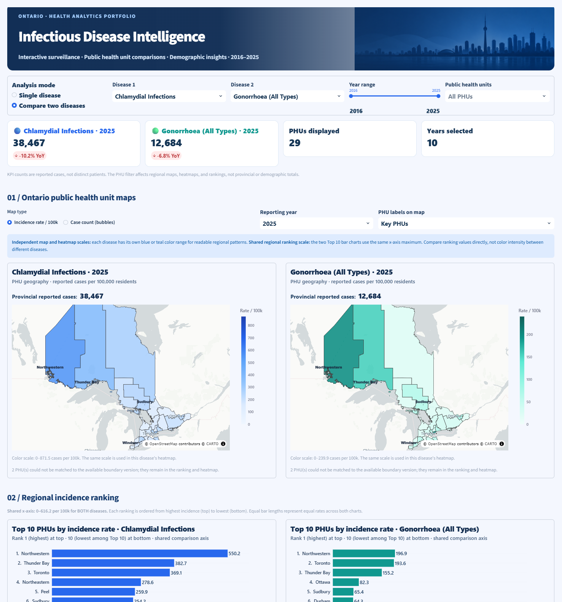
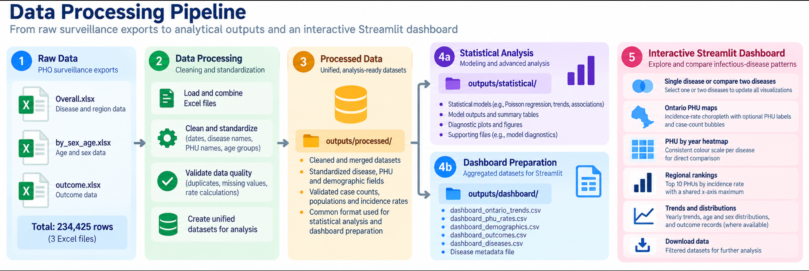
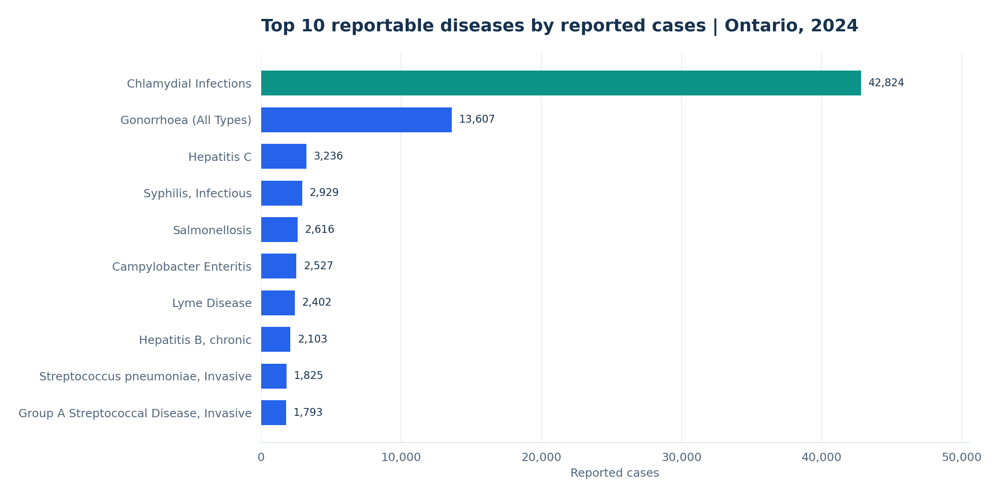
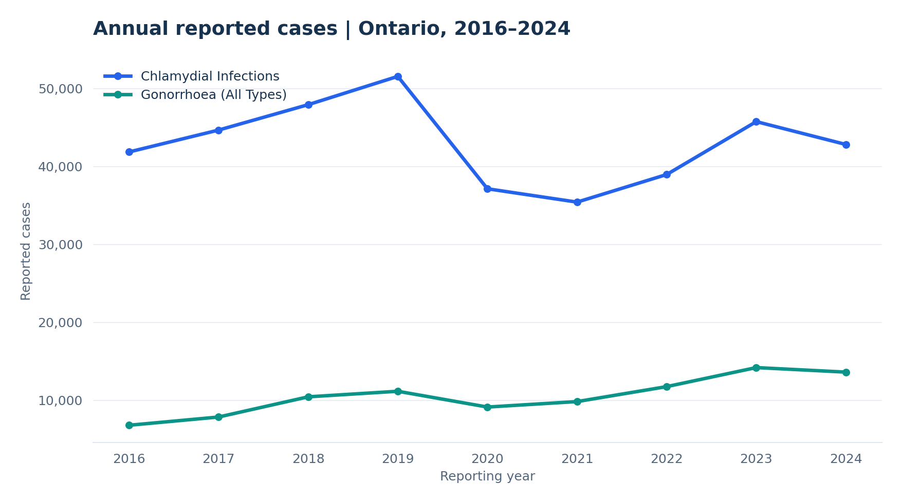
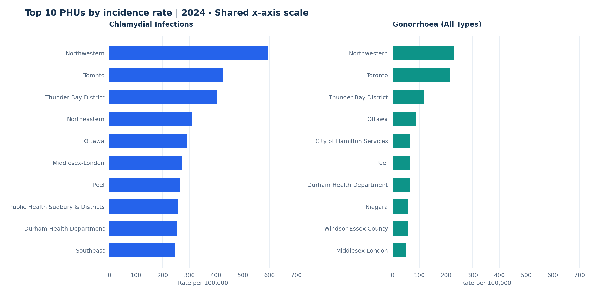
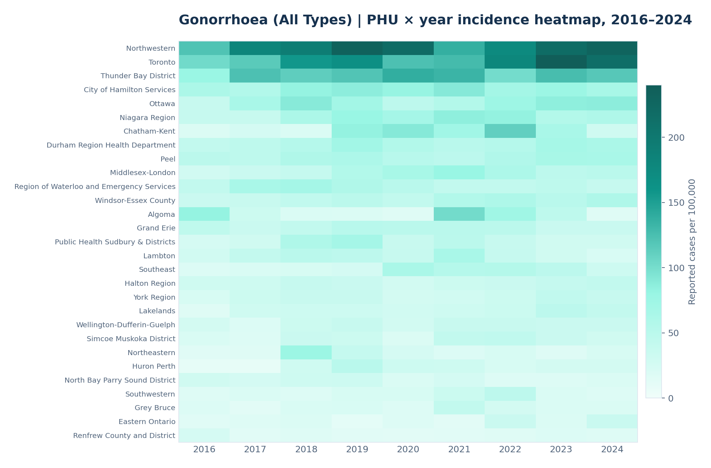

# Ontario Infectious Disease Intelligence

**Reproducible infectious-disease surveillance analytics and an interactive dashboard for Ontario (2016–2025).**

###     [Explore the Live Dashboard](https://ontario-infectious-disease-intelligence-honarvar.streamlit.app/)

&nbsp;

[](https://www.python.org/)
[](https://streamlit.io/)
[](https://plotly.com/python/)

> **Portfolio project:** Uses aggregated surveillance data, not individual patient records. Not intended for real-time surveillance or clinical decision support.

---


## Project Overview

This project examines **234,425 source data rows** across three Public Health Ontario surveillance exports, covering **67 infectious diseases**, **29 Public Health Units (PHUs)** and reporting years **2016–2025**. The inputs include **213,741 age/sex-stratified rows**. These counts describe *aggregated reporting records*, not unique patients or 234,425 infections.

Using **Python, pandas, Jupyter, statistical modelling methods and Streamlit**, the project investigates reported case burden, incidence rates, regional differences, demographic distributions and available outcomes. Its distinguishing feature is a **side-by-side comparison of two selected diseases** across linked geographic maps, regional rankings, annual trends and heatmaps.

**Workflow at a glance:** 3 Excel sources → quality assessment and preparation → analysis-ready data → independent statistical-analysis and dashboard-preparation branches → interactive Streamlit app.

## Table of Contents

1. [Dashboard Preview](#dashboard-preview)
2. [Data Sources & Scope](#data-sources--scope)
3. [Data Processing Pipeline](#data-processing-pipeline)
4. [Analysis Workflow](#analysis-workflow)
5. [Analytical Outputs & Results](#analytical-outputs--results)
6. [Interactive Dashboard](#interactive-dashboard)
7. [Selected Visualizations](#selected-visualizations)
8. [Repository Structure](#repository-structure)
9. [Installation & Usage](#installation--usage)
10. [Interpretation & Limitations](#interpretation--limitations)
11. [Next Steps](#next-steps)
12. [References](#references)

## Dashboard Preview

The Streamlit dashboard supports both focused single-disease exploration and **side-by-side comparison of two diseases**, including incidence maps, PHU rankings, yearly trends and demographic views. The [Interactive Dashboard](#interactive-dashboard) section describes its analytical features.



## Data Sources & Scope

The project uses aggregated **Public Health Ontario (PHO)** reportable-disease surveillance exports. The raw input files are:

| Source workbook | Raw data rows | What it provides |
|---|---:|---|
| `Overall.xlsx` | 20,034 | Disease counts and population-based measures at provincial/regional reporting levels |
| `by_sex_age.xlsx` | 213,741 | Age- and sex-stratified reported-case records |
| `outcome.xlsx` | 650 | Available disease-related outcome records |
| **Total** | **234,425** | **Aggregated source rows, not individual patient records** |

The exports span **2016–2025**, though **2025 completeness has not been established**. Reporting coverage and available breakdowns differ by disease and measure. The main data encompass 67 diseases and 29 named Ontario PHUs; provincial and occasional other aggregate geography entries must not be counted as additional PHUs.

**Original source:** [Public Health Ontario: Reportable Disease Trends Annually](https://www.publichealthontario.ca/en/Data-and-Analysis/Infectious-Disease/Reportable-Disease-Trends-Annually). The page links to the official surveillance resource; the specific download dates, export versions and applicable reuse conditions have not been verified and should be recorded before publication.

## Data Processing Pipeline

The architecture separates **analysis-ready inputs** from **downstream statistical analyses** and **dashboard-specific tables**. The `statistical/` and `dashboard/` branches are conceptually parallel. The dashboard does **not** depend on fitted regression results.



1. **Ingest and assess:** Load the three aggregated Excel exports and inspect fields, reporting grain, missingness, duplicate keys and consistency of disease/geography labels.
2. **Prepare reusable data (`outputs/processed/`):** Organize and standardize analysis-ready data while preserving distinctions between Ontario-wide totals, PHU observations and demographic groupings. Any unresolved reconciliation or quality issues should remain visible.
3. **Analyze (`outputs/statistical/`):** Use prepared data for statistical modelling, model diagnostics and summary outputs **when executed and validated**. This is a separate analytical branch, not the input used by Streamlit.
4. **Prepare dashboard tables (`outputs/dashboard/`):** Produce disease/year-, PHU/disease/year-, demographic- and outcome-level datasets for responsive filtering and visualization.
5. **Visualize (`app.py`):** Read dashboard-ready tables and display paired disease views, maps, rankings, heatmaps, trends and available distributions.

**Transformation principle:** Aggregating to a smaller number of dashboard rows does not mean records were deleted, nor that the row counts represent patients. Tables have different observation grains and **must not be summed together**.

## Analysis Workflow

The project documents four Jupyter stages, presented in logical execution order:

| Stage | Notebook | Analytical purpose |
|---|---|---|
| 1 · Quality assurance | `notebooks/01_data_quality.ipynb` | Missingness, duplicate keys, geographical groupings, age-band consistency, case reconciliation and rate validation |
| 2 · Exploration | `notebooks/02_exploratory_analysis.ipynb` | Case burden, annual trends, PHU incidence patterns, age/sex breakdowns, available outcomes and year-over-year differences |
| 3 · Statistical methodology | `notebooks/03_statistical_analysis_revised.ipynb` | Poisson count regression with a log-population offset, uncertainty and dispersion-related diagnostics |
| 4 · Dashboard preparation | `notebooks/04_dashboard_preparation.ipynb` | Schema/grain checks, dashboard-specific aggregation, export and verification |

**Statistical analysis:** The third notebook reads the three processed CSVs and fits a Poisson regression to Ontario reported case counts with a log-population offset. Its source code includes SAS examples as reference only, not independently executed results. The separately supplied `outputs/statistical/` CSVs contain a **Lyme Disease** annual-trend example (2016–2024). Because the reported Pearson dispersion is approximately **70.2**, standard Poisson variance assumptions are strongly challenged: the trend estimate and associated inferential statistics should be treated as exploratory and **not as a validated public-health finding**. The model outputs are documented below, and the chart is labelled as a diagnostic, not as confirmation of fit.

## Analytical Outputs & Results

The three output folders have **different roles**, and the dashboard does **not** consume regression output. The original Excel exports contain **234,425 raw data rows**, while the three processed files have **234,423 rows**. The two-row difference occurs in the outcome data and should not be interpreted as a loss of patient observations: these are aggregated reporting rows.

### 1. Processed Data (`outputs/processed/`)

These **verified, analysis-ready CSVs** are read by both the statistical and dashboard-preparation notebooks. They preserve their distinct reporting grains rather than being merged into one patient-level table.

| File | Rows | Columns | Content and purpose |
|---|---:|---:|---|
| `pho_overall_tidy.csv` | 20,034 | 8 | Reported cases, population, rates per 100,000 and geography level for 67 diseases and 2016–2025; includes 18,734 PHU rows, 630 Ontario rows and 670 Canada rows |
| `pho_age_sex_tidy.csv` | 213,741 | 8 | Disease, year, geographic unit, sex, age group, case counts, population and reported rate; 67 diseases, three source sex labels and 26 source age-group labels |
| `pho_outcomes_tidy.csv` | 648 | 7 | Ontario-only deaths and hospitalizations with counts, denominators and reported percentages; available for 38 diseases, not the full disease list |
| **Total** | **234,423** | | **Processed aggregated records at differing reporting grains** |

The processed tables are **not unique people or individual infection events**. Ontario and PHU rows must not be summed, and disease-specific demographic age categories must not be assumed to be mutually exclusive across all tables.

### 2. Statistical Outputs (`outputs/statistical/`)

| File | Rows | What it contains |
|---|---:|---|
| `annual_trend_summary.csv` | 1 | Lyme Disease trend summary (2016–2024): annual rate ratio, approximate confidence interval and p-value, Pearson dispersion, number of years |
| `annual_trend_diagnostics.csv` | 9 | Annual observed cases, fitted cases, year-over-year changes, Pearson residuals and review flags |

The saved summary reports an annual rate ratio of approximately **1.164**, but **Pearson dispersion ≈ 70.2**, consistent with severe overdispersion relative to a basic Poisson model. The confidence interval and p-value should therefore **not be cited as robust evidence of an increasing incidence trend** without further model validation or appropriate alternative modelling.


*This diagnostic graph is generated directly from `annual_trend_diagnostics.csv`, not from invented statistical output. It is for model review, not prediction or outbreak confirmation.*

### 3. Dashboard Outputs (`outputs/dashboard/`)

| CSV file | Rows | Reporting grain and dashboard role |
|---|---:|---|
| `dashboard_ontario_trends.csv` | 630 | Disease × year; Ontario-wide case counts, population and PHO-reported incidence |
| `dashboard_phu_rates.csv` | 18,734 | PHU × disease × year; regional counts, population and rates across 29 named PHUs |
| `dashboard_demographics.csv` | 7,860 | Ontario disease × year × sex × source-defined age group; cases and population |
| `dashboard_outcomes.csv` | 648 | Disease × year × available reported outcome; hospitalizations and deaths where provided |
| `dashboard_diseases.csv` | 67 | Filter-list of available diseases |
| **Total** | **27,939** | **Rows across distinct dashboard views, not a single merged dataset** |

The dashboard-specific files are subsets or aggregations of the processed reporting tables. Fewer rows do **not** mean fewer patients, and the five tables cannot be simply added as if they were non-overlapping case records.

## Interactive Dashboard

The Streamlit app emphasizes interpretable comparisons of disease-specific surveillance measures:

- **Interactive disease comparison:** Explore a single disease or compare two diseases side by side with linked visual panels.
- **PHU geospatial analysis:** Examine geographic incidence rates on choropleth maps when usable boundaries are available; marker fallbacks and optional labels/bubbles support geographic exploration.
- **Comparable regional rankings:** Review the Top 10 PHUs by disease-specific incidence; paired bar charts use a **shared horizontal-axis maximum**.
- **Temporal trends and heatmaps:** Explore year-by-year reported counts/rates and PHU-by-year patterns within the available 2016–2025 exports.
- **Demographic and outcome analysis:** Inspect age-group, sex and available outcome data where source coverage permits.
- **Dynamic filters and export:** Select diseases, reporting period and PHUs, then download filtered datasets.

For clarity, the first selected disease is visualized in blue and the second in teal/green. **Map and heatmap color ranges are disease-specific**, so similar shades across different disease panels do *not* imply equal rates; use the printed values and shared-axis rankings for direct comparison.

## Selected Visualizations

The following figures were generated from project dashboard CSV exports. They are descriptive analyses, **not screenshots of the statistical notebook**, and use 2024 to avoid assuming completeness of the available 2025 data.

### Disease Burden in Ontario (2024)



### Comparing Two Disease Trends (2016–2024)



### Regional Rate Comparison (2024)



The paired PHU charts use a common horizontal scale for direct numerical comparison; incidence rates are disease-specific and must not be added.

### PHU-by-Year Heatmap



Blank or gray cells indicate unavailable rates, not zero cases. Different age groups, completeness and population denominators can limit comparability across diseases or years.

## Repository Structure

```text
PHO-Project/
├── app.py
├── README.md
├── requirements.txt
├── .gitignore
├── .streamlit/
│   └── config.toml
├── data/
│   └── ontario_phu_boundaries.geojson
├── notebooks/
│   ├── 01_data_quality.ipynb
│   ├── 02_exploratory_analysis.ipynb
│   ├── 03_statistical_analysis_revised.ipynb
│   └── 04_dashboard_preparation.ipynb
├── outputs/
│   ├── processed/
│   │   ├── pho_overall_tidy.csv
│   │   ├── pho_age_sex_tidy.csv
│   │   └── pho_outcomes_tidy.csv
│   ├── statistical/
│   │   ├── annual_trend_summary.csv
│   │   └── annual_trend_diagnostics.csv
│   └── dashboard/
│       ├── dashboard_ontario_trends.csv
│       ├── dashboard_phu_rates.csv
│       ├── dashboard_demographics.csv
│       ├── dashboard_outcomes.csv
│       └── dashboard_diseases.csv
└── assets/
    ├── data_pipeline.png
    ├── dashboard_preview.png        # your actual Streamlit screenshot (add this file)
    ├── toronto_skyline.png
    └── figures/
        ├── top_10_diseases_2024.png
        ├── annual_disease_trends_2016_2024.png
        ├── regional_incidence_comparison_2024.png
        ├── gonorrhoea_phu_heatmap_2016_2024.png
        └── lyme_observed_vs_fitted_2016_2024.png
```

The tree describes the recommended GitHub project layout. The accompanying documentation package provides the README and its figure assets, **not the entire app, notebooks, original Excel sources or processed tables**. Confirm paths and repository permissions before publishing; do not commit virtual environments or credentials.

## Installation & Usage

From the repository root, install the dependencies in `requirements.txt` and run `app.py`. The four analytical dashboard CSVs must be available in `outputs/dashboard/`; the disease metadata file is also part of the prepared exports.

**Windows PowerShell**

```powershell
python -m venv .venv
.\.venv\Scripts\python.exe -m pip install -r requirements.txt
.\.venv\Scripts\python.exe -m streamlit run app.py
```

**GitHub Codespaces / Linux**

```bash
python -m venv .venv
.venv/bin/python -m pip install -r requirements.txt
.venv/bin/python -m streamlit run app.py --server.address 0.0.0.0 --server.port 8501
```

The app normally serves at `http://localhost:8501` (Codespaces may provide a forwarded port). Commit the required CSVs and referenced map assets before deployment to Streamlit Community Cloud.

## Interpretation & Limitations

- **Aggregated data:** Rows are not unique patients. One person can contribute more than one report; overlapping reporting grains cannot be summed.
- **Province vs PHU:** Do not add Ontario summary rows to PHU rows. Provincial KPIs need not change with PHU filters.
- **Disease-specific rates:** Incidence rates per 100,000 cannot be summed across diseases or reporting years; raw demographic counts are not age-standardized incidence rates.
- **Incomplete or changing coverage:** Verify 2025 completeness and reporting lag before drawing conclusions. Surveillance practices and disease definitions can change over time.
- **Geographic boundaries:** Current PHU boundary geometry may differ from historical reporting groupings and mergers.
- **Missing outcomes:** Absence of outcome data is not evidence of zero outcomes; definitions and reporting coverage vary.
- **Interpretation:** Trends can reflect testing access, reporting practice, disease definitions, pandemic disruptions and actual disease dynamics. Descriptive comparisons do not establish causality.
- **Inferential results:** No unexecuted or unreviewed Poisson-model findings are presented as measured effects.

## Next Steps

- Reconcile processed/statistical directory file lists with actual code and commit history; document inputs, outputs and reproducibility at each stage.
- Execute and review statistical notebooks end-to-end before reporting coefficients, intervals, p-values or model-based conclusions.
- Verify source download URLs, dates, applicable reuse conditions and 2025 coverage.
- Add a clean **real screenshot** of the Streamlit dashboard and publish a verified deployment link.
- Add verified generated analytical figures to `assets/figures/` where they improve explanation.

## References

- [Public Health Ontario: Reportable Disease Trends Annually](https://www.publichealthontario.ca/en/Data-and-Analysis/Infectious-Disease/Reportable-Disease-Trends-Annually)

---

*Portfolio demonstration of reproducible analytics using aggregated infectious-disease surveillance data; not intended for clinical use or live public-health alerting.*
